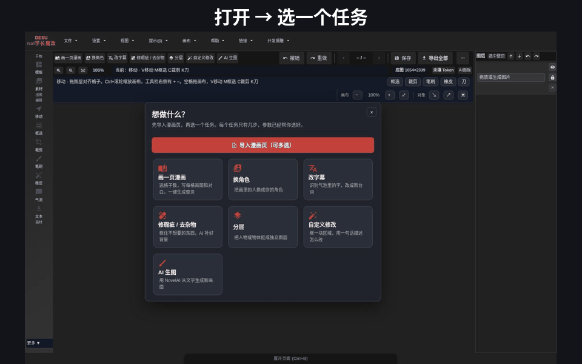
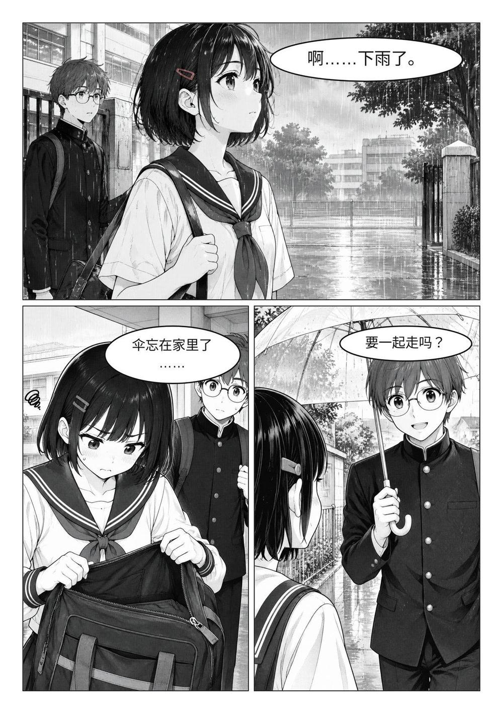
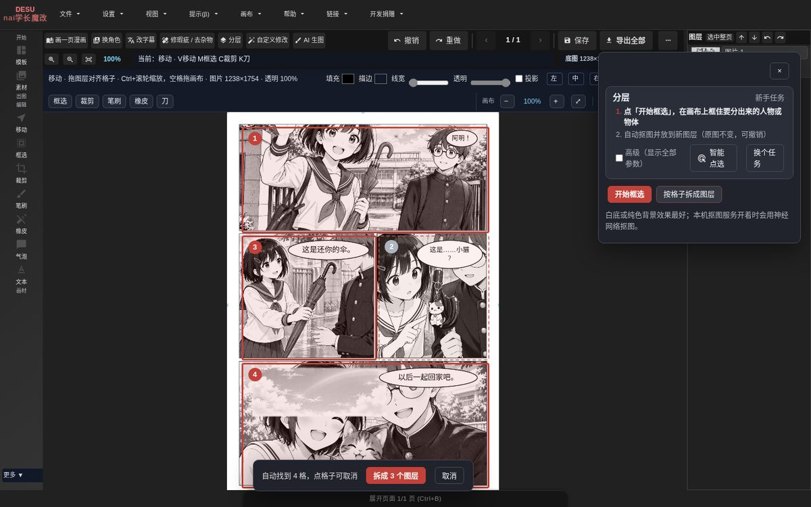
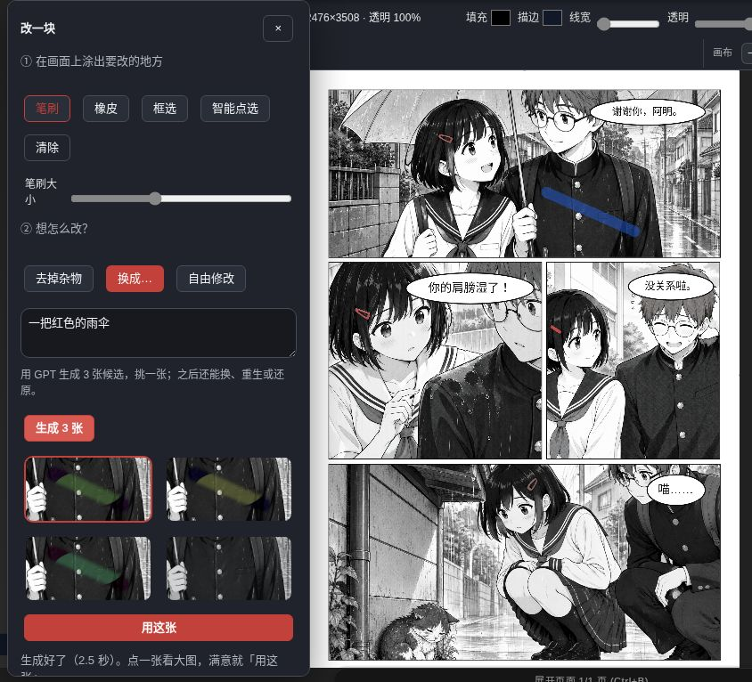
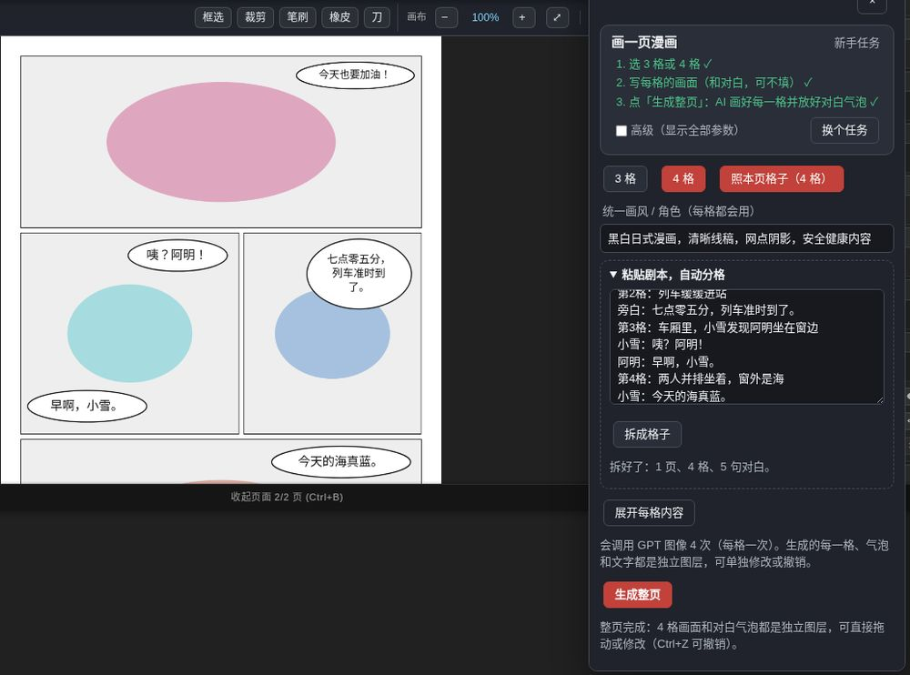
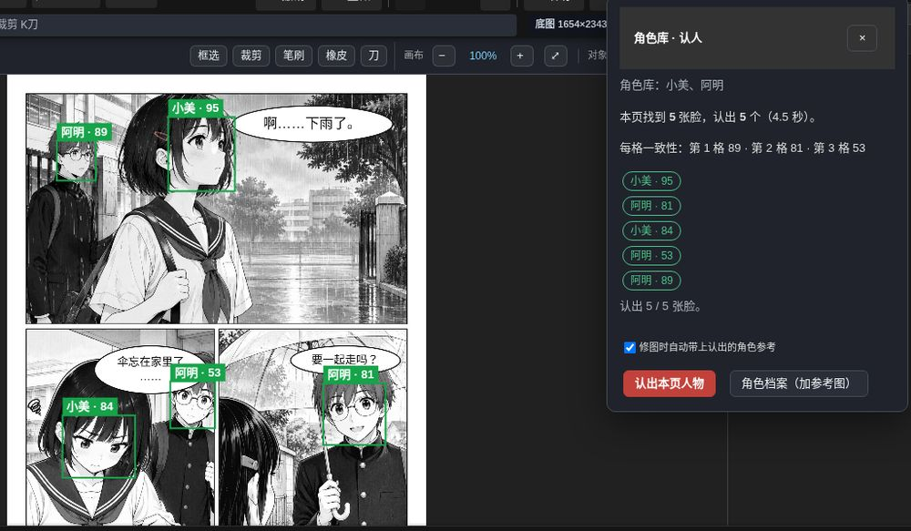
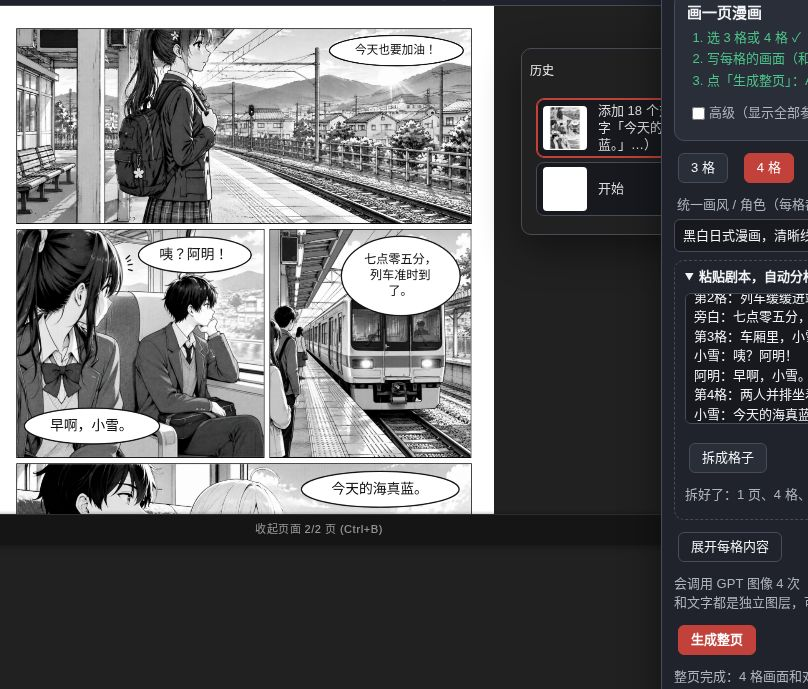
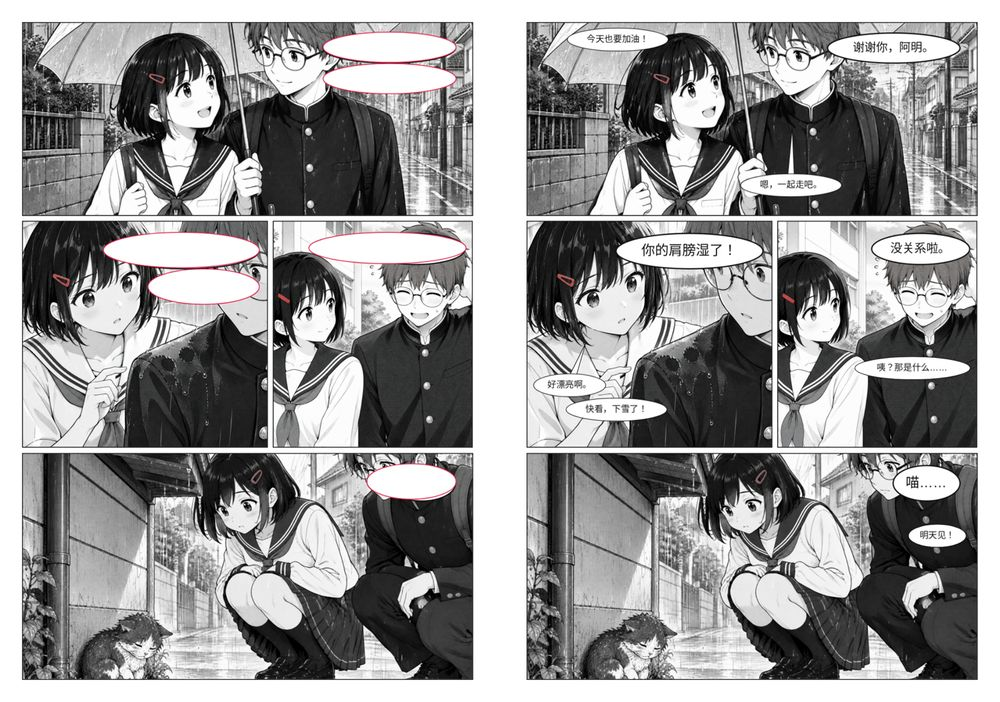
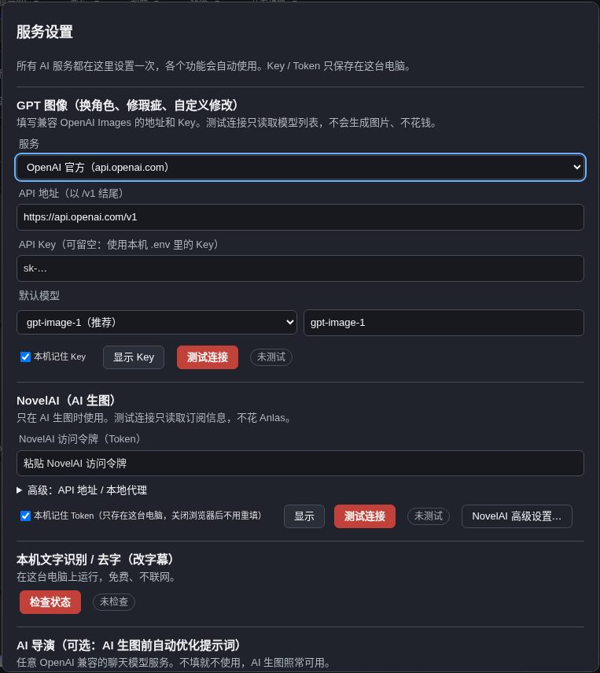

# Manga-NAI-GPT

**新手也能用的漫画修图 / 嵌字工具**：换角色、改字幕、去杂物、拆图层、画一整页，大多数事情点 2–4 下就完成。

**中文** · [English](README_EN.md) · [5 分钟上手](docs/QUICK_START_BEGINNER.md) · [文档](docs/README.md) · [更新记录](CHANGELOG.md)

Manga-NAI-GPT 是基于 [Manga Editor Desu](https://github.com/new-sankaku/manga-editor-desu) 的漫画编辑器，把常见工作做成「任务卡」：打开页面、点一个任务、按 1-2-3 做完。文字识别、去字、抠图、找格子都在**你自己的电脑上用 CPU 运行**；需要重画的部分（换角色、画一页）调用**你自己设置的** OpenAI 兼容图像服务，AI 生图用 NovelAI。所有结果都是新图层，原图不动，`Ctrl+Z` 一步撤销。

## 功能

当前版本 **1.6.3**：首页 6 个任务，外加角色库、自动对白气泡、Ctrl+K 命令面板和带缩略图的历史、PSD 导入导出。1.6 起「改一块」「画一页」也可以用 NovelAI 画（支持 V5），生成前显示要花多少 Anlas。详见 [CHANGELOG](CHANGELOG.md)。

**本机后端（1.6.3）**：改字幕默认「检测后 Manga OCR 精修」（权重已缓存时自动精修；首次需确认下载约 400MB）；去掉杂物 / 去字默认 `auto` LaMa（有漫画微调权重则用漫画，否则通用）。全量审计 120/120 已在 1.6.2 关闭；本版为效果抛光，见 `docs/dev/smoke-163/`。

| 任务 | 做什么 | 需要 |
|---|---|---|
| **换角色** | 自动找出人物 → 点要换的人 → 上传参考图 → 预览对比 → 应用；同一角色可在其他格一起换（脸部识别） | 图像服务 + 本机人物识别 |
| **改字幕** | 导入时自动识别本页文字 → 直接改台词 → 原字擦掉、新字按气泡排版（中文避头尾，可保留拟声词） | 本机（免费） |
| **改一块** | 涂出一块 → 「去掉杂物」（本机，免费）/「换成…」/「自由修改」（3 张候选）→ 变成可再改、可还原的图层；接缝和色调自动对齐 | 本机 LaMa、GPT 或 NovelAI |
| **分层** | 智能点选人物（3 个候选）或按格子一键拆成图层 | 本机（免费） |
| **画一页漫画** | 粘贴剧本自动拆成格子和对白（或逐格写）→ 一键生成整页；对白气泡自动避脸、按从右到左的阅读顺序摆放；用 NovelAI 时可锁定种子让画风统一 | GPT 或 NovelAI |
| **AI 生图** | NovelAI 文生图 / 图生图 | NovelAI Token |
| **专业模式** | 原版全部工具：分镜、气泡、网点、笔刷、多页、模拟器、导出 | — |

| 随时可用 | 做什么 |
|---|---|
| **角色库**（⋯ 菜单） | 给角色存参考图，本页自动认出是谁；改图时自动带上该角色的参考 |
| **Ctrl+K 找功能** | 输入几个字就能找到并执行任何功能 |
| **历史面板** | 每一步都有中文名、时间和缩略图，点一下回到那一步 |
| **PSD 导入 / 导出** | 文件菜单；文字是可编辑文字层，AI 图层带蒙版 |
| **隐私模式**（⋯ 菜单） | 模糊历史、文件和候选缩略图，旁边有人时用 |
| **提示词助手**（服务设置里打开，默认关） | NovelAI 提示词框：Danbooru 标签补全和检查、`Ctrl+↑/↓` 调权重、读 PNG 里的生成参数；可选让你自己的聊天模型「润色/扩写」，改动先给你看对比再应用 |

| 换角色（左原图 / 右结果） | 一页完成稿 |
|---|---|
|  |  |
| **改字幕**：每页识别结果自动缓存 | **分层**：按格子拆成图层 |
|  |  |
| **改一块**：涂一块 → 换成… → 3 张候选 | **剧本成页**：粘贴剧本 → 格子、对白气泡 |
|  |  |
| **角色库**：本页自动认人 | **历史面板**：每步有名字和缩略图 |
|  |  |

**自动对白气泡**（左：旧的固定右上角；右：避脸、按阅读顺序）

## 安装（3 步）

需要 **Python 3.10+** 和 Chrome / Edge / Firefox。不需要显卡。

| | Windows 10/11 | macOS | Linux |
|---|---|---|---|
| 1. 下载 | [Releases](https://github.com/h1neolzr7f/Manga-NAI-GPT/releases/latest) 下载源码 ZIP，解压到短路径（如 `D:\MangaNAI`） | 同左，或 `git clone` | 同左，或 `git clone` |
| 2. 启动 | 双击 **`一键启动.bat`** | 终端运行 `./start.sh` | 终端运行 `./start.sh` |
| 3. 本机 AI（可选） | 双击 **`安装AI功能.bat`**，再 `winget install UB-Mannheim.TesseractOCR` | `bash scripts/install-ai.sh` 和 `brew install tesseract tesseract-lang` | `bash scripts/install-ai.sh` 和 `sudo apt install tesseract-ocr tesseract-ocr-jpn tesseract-ocr-chi-sim` |

浏览器会自动打开 `http://127.0.0.1:8000/index.html`。启动窗口就是本机服务，关掉它即停止。本机模型在第一次用到时才下载（先告诉你大小和许可证，你确认后下载并校验 SHA-256）。

## 快速上手

1. 点首页「**导入漫画页**」（可多选）。
2. 点一个任务，比如「**改字幕**」，按卡片上的 1、2、3 做。
3. 满意就「应用」，不满意 `Ctrl+Z`。完成后「**导出全部**」得到每页 PNG + 项目文件。

详细步骤见 **[docs/QUICK_START_BEGINNER.md](docs/QUICK_START_BEGINNER.md)**。

## 服务设置（所有地址和 Key 只在这里）

右上角 `⋯` → **服务设置**。每项都有自己的「测试连接」，测试不花钱。

| 服务 | 填什么 |
|---|---|
| GPT 图像（换角色、改一块的「换成…/自由修改」、画一页） | 「OpenAI 官方」或「自定义」（任意 OpenAI Images 兼容服务，地址以 `/v1` 结尾）+ API Key；测试后从该服务列出的模型里选 |
| NovelAI（AI 生图、改一块、画一页） | 访问令牌 Token；选模型（V5 / V4.5 / V4 / V3），下面会说明这个模型支持什么 |
| AI 导演 / 导入打标签（可选） | 你自己的聊天模型服务 / 本机 Tagger 地址 |
| 本机文字识别、去字、抠图 | 不需要 Key，只显示状态 |

- **没有内置中转站**，图片只发给你自己设置的服务。
- Key / Token 只保存在这台电脑；`.env` 里的 Key 只会发给服务设置里保存的地址。
- 没设置就点需要 GPT 的任务时，会直接打开服务设置并提示缺什么。
- **编辑器不过滤 NovelAI 提示词**，内容按你自己 NovelAI 账号的规则；想要的话可以在服务设置里打开「安全模式」（默认关）。GPT 服务拒绝时，会提示可以改用 NovelAI。
- NovelAI 生成前会显示预计 Anlas；Opus 会员在免费范围内（≤1024×1024、≤28 步、每次 1 张）显示「免费」，编辑器默认按这个范围出图。
- 请求发出后超时或断线时，结果算「未知」，**不会自动重试**，避免重复生成或扣费。

## 已知限制

- **换角色在复杂多人画格里不稳定**：偶尔会改到同格另一个人或比例不自然，请先看「对比原图」再应用。
- **自动找格子需要白色格间留白**：无边框、满版出血、黑底分格要手动框选。
- **本机 AI 只用 CPU**：首次人物识别 20–60 秒，内存 < 8 GB 的电脑会偏慢。
- **Windows 本机基础链路已验证**：本修复版已在 Windows 实机验证启动、导入、画布缩放、任务入口和响应式工具栏；完整图像推理、本机 OCR/LaMa 模型及不同 Windows 环境仍需各自验证。参见本机修复的回归记录与 [WINDOWS_READINESS](docs/dev/WINDOWS_READINESS.md)。
- 「改一块 → 换成…」已用真实 gpt-image-2.5 验证（3 张候选约 35 秒）：涂到的地方换得自然、格框不受影响；但**只改涂到的地方**，物体如果超出涂抹范围，露在外面的部分会保持原样（例如雨伞只有涂到的一截变红）。要换整个物体请把它整个涂满。黑白页上换成彩色物体时，涂抹范围里的其他东西也可能被轻微上色。角色库自动带参考的真实效果还没有在 1.5 上重新验证。
- NovelAI 选 V5 时，「改一块」的局部重绘暂时用 V4.5 重绘模型（V5 重绘接口还没验证）。「换角色」还只能用 GPT。
- 彩色页导出 PSD 约 16–18 MB（无损）；黑白页约 6 MB。
- 文字识别以日文漫画为主；手写体、艺术字识别率较低。

## 常见问题

**双击 `index.html` 打不开？** 要用启动脚本打开（浏览器在 `file://` 下禁用大部分功能）。

**8000 端口被占用？** 已有编辑器在运行时会直接打开浏览器；若是别的程序占用，关掉它再启动。也可以换端口：`MNAI_PORT=8001 ./start.sh`（Linux / macOS），然后打开 `http://127.0.0.1:8001/index.html`；两个版本可以这样同时运行。

**一定要 GPT / NovelAI 吗？** 不用。嵌字、改字幕、去字、分层、专业模式都可完全离线；只有换角色、画一页、改一块的「换成…/自由修改」需要图像服务。

**要显卡吗？** 不需要。

**1.6.5**：整页拆解为可编辑图层、批量导演（默认开）、竖排气泡；实验选项默认关。

**1.6.4 去字**：纯色气泡优先「气泡填底色」（不用下载模型）；复杂背景再下漫画 LaMa。一键包默认只带文字检测（约 91MB），其余在「服务设置」下载。

**模型放哪？** `~/.cache/manga-editor/`（Windows：`%USERPROFILE%\.cache\manga-editor\`）；设置 `XDG_CACHE_HOME` 可换盘。

**提示词助手的缩略图是空的？** 打开提示词助手点「下载示例图」（逐张校验）；不下载也能正常用提示词。

## 隐私与安全

本机服务只监听 `127.0.0.1`，所有本机接口检查同源；不含统计或跟踪代码。漏洞请按 [SECURITY.md](SECURITY.md) 私下报告。

## 致谢

- 上游项目 **[Manga Editor Desu](https://github.com/new-sankaku/manga-editor-desu)**（new-sankaku）——编辑器本体来自这里，本项目是其非官方修改版，与上游无附属关系，问题请在本仓库提。
- 本机模型与库：comic-text-detector、LaMa、SAM 2、isnet-anime、manga-ocr、Tesseract、deepghs 动漫人脸 / CCIP 等，完整列表与许可证见 [THIRD_PARTY_NOTICES.md](THIRD_PARTY_NOTICES.md)。

## 参与开发

见 [CONTRIBUTING.md](CONTRIBUTING.md)；开发文档在 [docs/dev/](docs/dev/)。

## 许可证

[GPL-3.0](LICENSE)，与上游相同。
